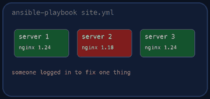

<p align="center"></p>

| | |
|-|-|
| **Time** | 90-105 min |
| **Cost** | free |
| **You need** | Ansible (ansible-core 2.15 or newer), Docker, git, an SSH client and a terminal (Linux, macOS, or Windows with WSL) |

## How this lab works

1. **Fork** this repository to your own GitHub account (button at the top right).
2. Clone **your fork** in your Ubuntu environment (WSL on Windows, your OrbStack machine on Mac).
3. Read the lab below (the same text is in [`LAB.md`](LAB.md)) and follow the mission.
4. Answer the questions in [`SUBMISSION.md`](SUBMISSION.md). Where a question asks for output, paste it in a code block. No screenshots needed.
5. Commit and push. Open the **Actions** tab of your fork (click *I understand my workflows, go ahead and enable them* the first time). The **Lab check** shows what is still missing.
6. When the check is green, **submit the URL of your fork** in the course platform.

> [!NOTE]
> The check only looks at your answers and any files the lab asks you to commit. Your instructor reads your work and may ask you to explain any line.

<p align="center"></p>

## 🎬 The situation

<p align="center"></p>

Monday morning. Three new servers arrived for the polls application: one for the website, one for the API and worker, one for the database. They are fresh Ubuntu installs and nobody has touched them.

The last team set up their servers by hand. Six months later nobody could say what was installed where, one server had a hand-edited config that nobody dared touch, and rebuilding it took a week. Your manager wants the opposite: **every change goes through code, and the code can be run again at any time without breaking anything.**

You will describe the servers in an inventory, configure them with one playbook, and then survive three colleagues who log in to "just fix one thing".

> [!IMPORTANT]
> **Your mission**
> - Log in to a server by hand once, so you know what Ansible replaces
> - Write the inventory and `ansible.cfg`, and reach all three servers with `ping`
> - Write `site.yml`: a baseline for every server, and Nginx serving Pollie's website on the web server
> - Prove it is idempotent: the second run changes nothing
> - Let `drift.sh` break things behind your back, then repair them with Ansible and nothing else

**Time:** 90-105 min | **Cost:** free | **You need:** Ansible (`ansible-core` 2.15 or newer), Docker, git, an SSH client and a terminal. On Windows use WSL. `./teardown.sh` removes the lab.

<p align="center"></p>

## Part 0 - Set the scene

Fork this repository, clone your fork, and run:

```bash
./setup.sh
```

It builds three small Ubuntu 24.04 servers (they run systemd and an SSH daemon, like real ones), creates an SSH key in `keys/` and clones Pollie. Read the table it prints. Nothing is installed on the servers yet, not even Nginx.

> **Why containers?** They behave like servers for our purpose: you reach them over SSH, you become root with `sudo`, you install with `apt` and manage services with `systemd`. Ansible cannot tell the difference, and they cost nothing.

If you do not have Ansible:

```bash
pipx install ansible-core        # or: python3 -m pip install --user ansible-core
ansible --version
```

<p align="center"></p>

## Part 1 - Do it by hand once

Log in to the web server:

```bash
ssh -i keys/id_ed25519 -o IdentitiesOnly=yes -p 2221 -o StrictHostKeyChecking=no deploy@127.0.0.1
```

Look around: `hostname`, `cat /etc/os-release | head -2`, `which nginx`, `sudo apt-get update`. Then log out with `exit`.

> [!NOTE]
> **Think** To make this server look like the plan (packages, a user, Nginx, a config file, the website) you would type about ten commands. For three servers that is thirty. For thirty servers three hundred, and one typo on server 17 that nobody notices until it matters. Write that thought in your own words for question 1.

<p align="center"></p>

## Part 2 - Tell Ansible about your servers

Ansible needs two things before it can do anything: a list of machines and the settings to reach them.

1. Fill in `inventory.ini`. You need the groups `web`, `app` and `db` (one host each, named `pa-web`, `pa-app`, `pa-db`) and a group `servers` that **contains the three groups** (a group of groups: `[servers:children]`). The user and key are the same for every server, so set them once for the group, not three times. Also set `ansible_ssh_common_args=-o IdentitiesOnly=yes`: if your SSH agent holds many keys, SSH offers them all before the right one and the server hangs up with *Too many authentication failures*.
2. Create `ansible.cfg` so you do not have to type `-i inventory.ini` every time. Tell it which inventory to use, that the servers' host keys are not checked (**only acceptable here**: the servers are brand new every time), and that Ansible should find the Python interpreter by itself.
3. Look at what you wrote:

```bash
ansible-inventory --graph
ansible-inventory --host pa-web
```

4. Reach them:

```bash
ansible all -m ping
```

You should see three green `SUCCESS` lines with `"ping": "pong"`.

> [!NOTE]
> **Think** This `ping` is not an ICMP ping. It logs in over SSH, finds Python on the server and runs a module. What does a green result prove that `ping 127.0.0.1` could not?

Now try **ad-hoc commands**, one-off tasks without a playbook:

```bash
ansible all -m command -a "uptime"
ansible web -m setup -a "filter=ansible_distribution*"
ansible all -m apt -a "name=jq state=present update_cache=yes" -b
```

The last one fails without `-b`. Run it both ways and read the error. (A brand-new server has an empty package index, hence `update_cache=yes`.)

> [!NOTE]
> **Predict** Run the `apt` command a **second** time. What will the colour be, and what will the output say instead of `changed`? Write down your guess, then check. This difference is the most important idea in the whole lab.

<p align="center"></p>

## Part 3 - The baseline playbook

Open `site.yml`. The first play targets the group `servers` and does the same things on all three machines:

| Requirement | Hint |
|-------------|------|
| Packages `curl`, `htop`, `jq` installed | module `apt` (with a list of names) |
| System group and user `pollie`, shell `/usr/sbin/nologin`, no home directory | modules `group`, `user` |
| Directory `/opt/pollie`, owned by `pollie` | module `file` |
| `/etc/motd` containing `Managed by Ansible` and the server's inventory name | module `copy` with `content:`, and the variable `inventory_hostname` |

Remember `become: true` at play level (the servers need root, the SSH user is `deploy`). Look up each module in the documentation: `ansible-doc ansible.builtin.apt` works offline.

Run it:

```bash
ansible-playbook site.yml
```

Read the output. Each task shows `ok`, `changed` or `failed` per host. Then run it **again**.

> [!NOTE]
> **Think** The first run printed `changed` for most tasks. The second printed `ok`. The playbook did not remember anything: each module looked at the server, compared it to the wanted state, and only acted when they differed. Now imagine you wrote `command: apt-get install -y jq`. What would the second run say, and why would a real production system hate it?

<p align="center"></p>

## Part 4 - Nginx, a template and a handler

Add a second play for the group `web`:

1. Install `nginx`. Ubuntu starts it with a default site that listens on port 80 as well, so **remove `/etc/nginx/sites-enabled/default`**. If you forget, your site loses a fight for the port in a confusing way.
2. Copy Pollie's static website (the folder `pollie/web/` that `setup.sh` cloned) to `/var/www/pollie/`.
3. Write `templates/pollie.conf.j2`, an Nginx server block that: listens on port 80, uses the inventory name as `server_name`, serves `/var/www/pollie`, adds the response header `X-Served-By` with the inventory name, and starts with a comment saying the file is managed by Ansible. The `{{ inventory_hostname }}` variable goes straight into the template.
4. Render it to `/etc/nginx/conf.d/pollie.conf` with the `template` module.
5. Make sure Nginx is `started` and `enabled`.
6. Reload Nginx **only when something changed**, using a **handler**: give the config and default-site tasks `notify: Reload nginx`, and define the handler in a `handlers:` section of the play.

Run it. Then test from your machine:

```bash
curl -i http://localhost:8080
```

You should see Pollie's page and your `X-Served-By` header. Open it in a browser too.

> [!TIP]
> **Checkpoint** `curl -sI localhost:8080 | grep -i x-served-by` prints `X-Served-By: pa-web`, and a second `ansible-playbook site.yml` shows `changed=0` on all three hosts.

### Break it on purpose

1. Change one line of the template (for example the header name or value) and run the playbook. Which task is `changed`? Does the handler run? On how many hosts?
2. Run the playbook again without changing anything. Does the handler run now?
3. Run `ansible-playbook site.yml --check --diff` after another small template change, **before** applying it. Read the diff. This is how you review a change on a server you are afraid to touch.

> [!NOTE]
> **Think** Without the handler you would have two bad options: restart Nginx on every run (a blip for every user, every time, even when nothing changed), or never restart it (the new config is on disk but not live). The handler is the third option.

<p align="center"></p>

## Part 5 - Colleagues with SSH access

Real servers do not stay as you left them. Run:

```bash
./drift.sh
```

It simulates three people who logged in to "just fix one thing" and did not tell anybody. You do not know what they did. Ansible does:

```bash
ansible-playbook site.yml --check --diff
```

Read the output for each host. Which tasks would change, and what exactly differs? Then repair everything the right way:

```bash
ansible-playbook site.yml
```

Check the website again, and run the playbook once more to see `changed=0`.

> [!NOTE]
> **Think** You never logged in to those servers to repair them. The playbook is both the documentation of how a server should look and the tool that makes it so. What does that mean for the next person who is tempted to "just fix one thing" by hand?

<p align="center"></p>

## Part 6 - Prove it

<p align="center"></p>

```bash
./verify.sh
```

It reads your inventory, runs your playbook against the servers, checks the state of all three machines, simulates the drift and the repair, and checks again. Fix what is red and run it again until it ends with **ALL CHECKS PASSED**.

> [!TIP]
> **Stuck?** Run with `-v` (or `-vvv`) to see what Ansible sends. `ansible-doc <module>` shows examples at the bottom. A task that is `changed` on every run usually uses `command`, a `copy` that rewrites a file with different content each time, or a template that contains something that changes (like a timestamp). Idempotency problems show up in the second run, never the first.

<p align="center"></p>

## Level up (optional)

- Add `--limit pa-web` and `--tags` to your runs: apply one host or one slice of the play.
- Put the web root in a variable (`vars:` or `group_vars/web.yml`) and see where else you used it.
- Use `ansible-playbook site.yml --check` as a CI step: a green run without changes means "production matches Git".
- Next lab: the same servers, but with roles, templates for the whole Pollie stack, and secrets in Ansible Vault.

<!-- teardown:start (generated by labs.py, do not edit) -->
## Tear down (mandatory)

<p align="center"></p>

Resources left behind cost money, keep doors open and pollute the next lab. Removing what you created is part of the job, so it is part of the submission: **you must prove it is gone**.

Do this **last**, after you have pasted your `verify` output into `SUBMISSION.md` (once you tear down, the lab can no longer be verified).

1. Run `./teardown.sh`. It removes the three servers (labelled `lab=ansible-first-playbook`), their network, the generated SSH keys and the cloned Pollie source. Your Ansible files and answers stay.

Then run the proof:

```bash
./verify-teardown.sh
```

It prints a list of checks and must end with **TEARDOWN VERIFIED**. If it reports leftovers, remove them and run it again. Paste the full output in your submission.
<!-- teardown:end -->

<!-- submission:start (generated by labs.py, do not edit) -->
## 📬 Submission

Answer the questions in `SUBMISSION.md` in **your fork** (paste output in code blocks where asked), push, then submit the **URL of your fork**.

**Files to commit**

- `ansible.cfg`: your Ansible settings
- `inventory.ini`: the three servers, grouped by role
- `site.yml`: the playbook
- `templates/pollie.conf.j2`: the Nginx site template

**Questions to answer**

1. Before Ansible: paste the `ssh` command you used to log in to `pa-web` and the output of `hostname; cat /etc/os-release | head -2; which nginx`. Now imagine 30 servers: what exactly would you repeat, and what is the chance all 30 end up identical?
2. Paste your `inventory.ini` and the output of `ansible-inventory --graph`. Why groups (`web`, `app`, `db`) and not just a list of three hosts? What does `[servers:children]` give you?
3. Paste `ansible all -m ping` and one ad-hoc command you ran (for example `-m command -a "uptime"` or `-m setup -a "filter=ansible_distribution*"`). What does `ping` check that the shell command of the same name does not? What does `-b` do?
4. Run your playbook twice. Paste the `PLAY RECAP` of the first run and of the second. Why must the second say `changed=0`, and which of your tasks would have broken that if you had used `command` or `shell` instead of a module?
5. Change one line of the Nginx template (for example the `server_name` or a header), run again and paste the recap. Which task changed, which handler ran, and on how many hosts? What would have happened to a running Nginx if the config was changed without a handler?
6. Run `./drift.sh` (it simulates three people logging in to "just fix one thing"), then `ansible-playbook site.yml --check --diff` before applying. Paste what Ansible says it would change and why `--check` is the command you run on a production system first. Then apply and paste the recap.
7. You used the `apt`, `service`/`systemd`, `copy` or `template`, `user` and `file` modules. For each, one sentence: what state does it describe, and how does it know nothing needs doing?
8. Paste the output of `./verify.sh`. It must end with **ALL CHECKS PASSED**.
9. **Tear down.** Paste the output of `./verify-teardown.sh`. It must end with **TEARDOWN VERIFIED**.
<!-- submission:end -->
